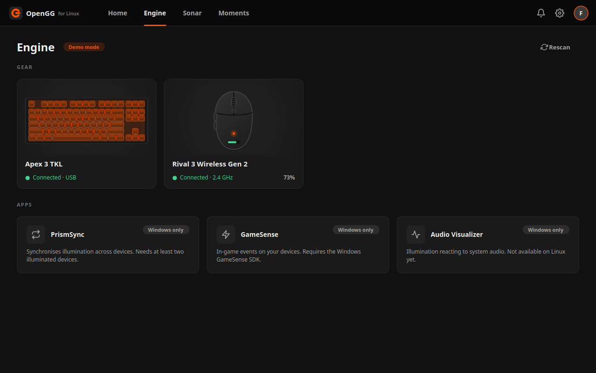
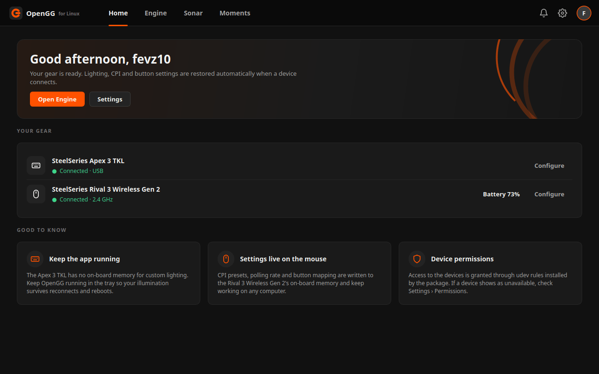
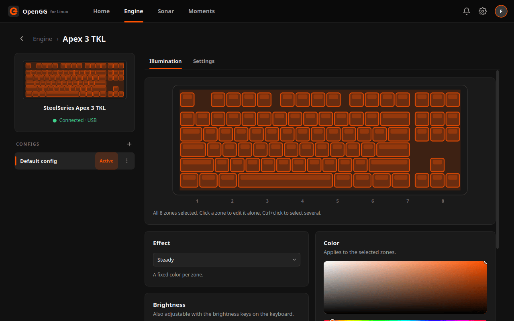
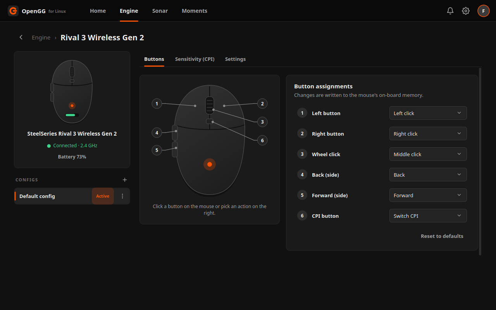

<div align="center">

<picture>
  <source media="(prefers-color-scheme: dark)" srcset="docs/logo-dark.svg">
  
</picture>

**An open-source, unofficial alternative to SteelSeries GG for Linux —
configure your Apex 3 TKL keyboard and Rival 3 Wireless Gen 2 mouse with a familiar GG-style interface.**

[](https://github.com/fevz10/opengg/actions/workflows/build.yml)
[](https://github.com/fevz10/opengg/releases)
[](LICENSE)
[](https://www.qt.io)
[](#)
[-informational?logo=linux&logoColor=white)](#-installation)



</div>

---

## ✨ Highlights

- 🎨 **Feels like GG** — dark theme, orange accent, Home / Engine / Sonar / Moments tabs, gear cards, per-device *configs* and tabbed device pages.
- ⌨️ **Apex 3 TKL** — 8-zone illumination with click-to-select zones, *Steady · Breathe · Color Shift · Rainbow Wave · Off*, brightness that stays in sync with the keyboard's own Fn keys, and lights-off-when-idle.
- 🖱️ **Rival 3 Wireless Gen 2** — up to 5 CPI presets (100 – 18 000, separate X/Y), polling rate, full remapping of all 6 buttons, battery level with low-battery alerts — all written to the mouse's on-board memory.
- 💾 **Configs** — create, rename, duplicate and delete configs per device; the active one is re-applied automatically whenever a device reconnects.
- 🧰 **Native and lightweight** — Qt 6 Widgets + hidapi, no Electron, no background services. Talks to the hardware directly over HID; no account, no cloud.
- 🧪 **Demo mode** — explore the whole UI without any hardware (`opengg --demo`).
- 🌍 **English & Turkish** UI, system tray, autostart, udev rules bundled in the `.deb`.

## 📸 Screenshots

| Home | Engine |
|:--:|:--:|
|  |  |
| **Apex 3 TKL · Illumination** | **Rival 3 Wireless Gen 2 · Buttons** |
|  |  |

## 🔌 Supported hardware

| Device | USB ID | What you can configure |
|---|---|---|
| **SteelSeries Apex 3 TKL** | `1038:1622` | 8 illumination zones, effects, brightness (Fn+F11/F12 sync), idle dimming, restore on reconnect |
| **SteelSeries Rival 3 Wireless Gen 2** (2.4 GHz receiver) | `1038:1872` | CPI presets, polling rate (125/250/500/1000 Hz), button mapping, battery, on-board memory |

The device protocols are derived from the excellent [rivalcfg](https://github.com/flozz/rivalcfg)
and [OpenRGB](https://gitlab.com/CalcProgrammer1/OpenRGB) projects.
Hardware reports — especially for the Gen 2 mouse — are very welcome; the
**Settings → HID traffic log** shows exactly what is sent to the devices.

## 🚀 Installation

### From the release package

Download the `.deb` for your Ubuntu release from the
[Releases](https://github.com/fevz10/opengg/releases) page and install it:

```bash
sudo apt install ./opengg_*.deb
```

| Package | Ubuntu release | Qt |
|---|---|---|
| `opengg_<version>+jammy_amd64.deb` | 22.04 LTS | 6.2 |
| `opengg_<version>+noble_amd64.deb` | 24.04 LTS | 6.4 |
| `opengg_<version>+resolute_amd64.deb` | 26.04 LTS | 6.8 |

Other Debian based distributions work too; build from source (below) so the
package matches your Qt version.

The package installs the application, the desktop entry, the icon and the
**udev rules** (`/usr/lib/udev/rules.d/70-opengg.rules`) that let your user
talk to the devices without root. Replug the devices if they were already
connected.

### From source

```bash
git clone https://github.com/fevz10/opengg.git
cd opengg
./scripts/build-deb.sh --deps      # installs build dependencies via apt
./scripts/build-deb.sh --install   # builds, runs the tests, packages and installs
```

<details>
<summary>Manual build</summary>

```bash
sudo apt install build-essential cmake pkg-config qt6-base-dev qt6-base-dev-tools \
     qt6-svg-dev qt6-l10n-tools qt6-tools-dev-tools libhidapi-dev libgl1-mesa-dev
# Ubuntu 22.04: use libqt6svg6-dev instead of qt6-svg-dev

cmake -S . -B build -DCMAKE_BUILD_TYPE=Release
cmake --build build --parallel
ctest --test-dir build                 # protocol unit tests
./build/opengg --demo                  # try it without hardware
(cd build && cpack -G DEB)             # produce the .deb

# running from the build tree instead of installing the package:
./scripts/install-udev-rules.sh
```

Requirements: Qt ≥ 6.2 (Widgets, Svg, Network; DBus and LinguistTools optional),
hidapi (hidraw backend), CMake ≥ 3.16, a C++17 compiler.
</details>

## 🖥️ Usage

```
opengg [--demo] [--minimized] [--lang en|tr] [--config FILE] [--verbose] [--screenshot DIR]
```

| Option | Description |
|---|---|
| `--demo` | Simulated devices, no hardware access |
| `--minimized` | Start hidden in the system tray (used by *Launch at login*) |
| `--lang en\|tr` | Override the interface language |
| `--config FILE` | Alternative config file (default `~/.config/opengg/config.json`) |
| `--verbose` | Print the HID traffic to stderr |
| `--screenshot DIR` | Render every page to PNG files and exit (development aid) |

> **Why does it keep running in the tray?** The Apex 3 TKL has no on-board
> memory for custom lighting: it falls back to its built-in rainbow animation
> whenever the host stops sending colors. SteelSeries GG on Windows behaves the
> same way. Enable *Launch at login* in Settings so your lighting is restored
> after a reboot.

## 🧠 How it works

```
src/core       theme & icons · JSON config store · autostart · idle detection (D-Bus) · single instance
src/hid        asynchronous hidapi transport on its own thread (with a mock backend for --demo)
src/devices    hot-plug discovery · Apex3Tkl · Rival3WirelessGen2 · pure packet builders (Protocol.cpp)
src/models     KeyboardConfig / MouseConfig (JSON serialisable)
src/lighting   software effect engine (Breathe, Color Shift, preview frames at 20 fps)
src/ui         GG-style widgets and pages (QWidgets + QSS)
packaging/     .desktop · udev rules · icon · AppStream metainfo · Debian maintainer scripts
tests/         QtTest unit tests for every packet format
translations/  Turkish translation (.ts)
```

<details>
<summary>Protocol cheat sheet</summary>

**Apex 3 TKL** — HID interface 1, 64-byte reports (report id `0x00`)

| Command | Meaning |
|---|---|
| `21 FF r1 g1 b1 … r8 g8 b8` | set the 8 zone colors (`FF` = zone mask) |
| `22 FF` | hardware rainbow wave |
| `23 nn` | brightness, `00`–`10` |
| `A3` | query brightness → answer `A3 nn` |

**Rival 3 Wireless Gen 2** — HID interface 3, 50 ms between commands

| Command | Meaning |
|---|---|
| `2C n sel x1…x5 y1…y5` | CPI presets (TrueMove Air code table, `sel` is 1-based) |
| `17 v` | polling rate: `00`=1000 Hz, `01`=500, `02`=250, `03`=125 |
| `19` + 6 × 5 bytes | button mapping (`51` keyboard, `61` multimedia, `30` CPI switch, `31/32` scroll) |
| `AA 01` | battery query → `[level, ?, charging]` |
| `09` | save to on-board memory |
</details>

## 🗺️ Roadmap

- [ ] More SteelSeries devices (the device layer is table-driven — see `src/devices/Protocol.cpp` and `DeviceManager::supportedModels()`)
- [ ] Per-key / per-app config switching
- [ ] AppImage / Flatpak builds
- [ ] Audio visualizer effect (PipeWire)

## 🤝 Contributing

Issues and pull requests are welcome. To add a device: describe its packets in
`src/devices/Protocol.cpp`, add a `Device` subclass, register the product ID in
`DeviceManager::supportedModels()` and the udev rules, and cover the packets
with a test in `tests/ProtocolTests.cpp`. UI strings go through `tr()`;
run `lupdate src -ts translations/opengg_tr.ts` to refresh the translation file,
and `./scripts/update-screenshots.sh` to regenerate the README screenshots from
demo mode (optionally optimised with `pngquant`).

## 🙏 Acknowledgements

- [rivalcfg](https://github.com/flozz/rivalcfg) — Rival 3 Wireless Gen 2 protocol
- [OpenRGB](https://gitlab.com/CalcProgrammer1/OpenRGB) — Apex 3 TKL (8-zone) protocol
- [Feather Icons](https://feathericons.com) — base of the monochrome icon set
- [Qt](https://www.qt.io) and [hidapi](https://github.com/libusb/hidapi)

## ⚖️ License & disclaimer

Released under the [MIT License](LICENSE).

OpenGG is an independent community project. It is **not affiliated with,
endorsed by or supported by SteelSeries**. SteelSeries, SteelSeries GG, Apex
and Rival are trademarks of SteelSeries ApS and are used here only to identify
the compatible hardware. Use at your own risk — the application only sends the
documented commands above, but it does talk to your hardware directly.

---

<details>
<summary>🇹🇷 <b>Türkçe</b></summary>

### OpenGG

SteelSeries GG'nin yerine geçmek üzere Linux için yazılmış, **resmi olmayan**,
açık kaynaklı bir masaüstü uygulaması (Qt 6). **Apex 3 TKL** (8 bölgeli
aydınlatma, efektler, parlaklık, boştayken kapatma) ve **Rival 3 Wireless
Gen 2** (CPI ön ayarları, yoklama hızı, düğme atamaları, pil) cihazlarını
doğrudan HID üzerinden yapılandırır; SteelSeries hesabı veya servisi gerekmez.

**Kurulum:** [Releases](https://github.com/fevz10/opengg/releases) sayfasından
Ubuntu sürümünüze uygun `.deb` dosyasını (22.04 *jammy*, 24.04 *noble*,
26.04 *resolute*) indirip `sudo apt install ./opengg_*.deb` komutuyla kurun.
Paket, cihaz erişimi için gereken udev kurallarını da kurar.

**Kaynaktan derleme:** `./scripts/build-deb.sh --deps` (bağımlılıkları kurar),
ardından `./scripts/build-deb.sh --install` (derler, testleri çalıştırır,
paketi üretip kurar). Donanım olmadan denemek için `opengg --demo`.

**Neden tepside çalışmaya devam ediyor?** Apex 3 TKL'nin özel aydınlatma için
yerleşik belleği yoktur; renkler gönderilmeyi kesince klavye fabrika
animasyonuna döner. Ayarlar'dan *Oturum açılınca başlat* seçeneğini açarsanız
aydınlatmanız yeniden başlatmalardan sonra da geri yüklenir.

Arayüz dili sistem diline göre otomatik seçilir (Türkçe / İngilizce);
Ayarlar sayfasından değiştirilebilir.

SteelSeries ile bağlantılı değildir, SteelSeries tarafından onaylanmamış ve
desteklenmemektedir; marka adları yalnızca uyumlu donanımı belirtmek için
kullanılmıştır. Lisans: MIT.
</details>
